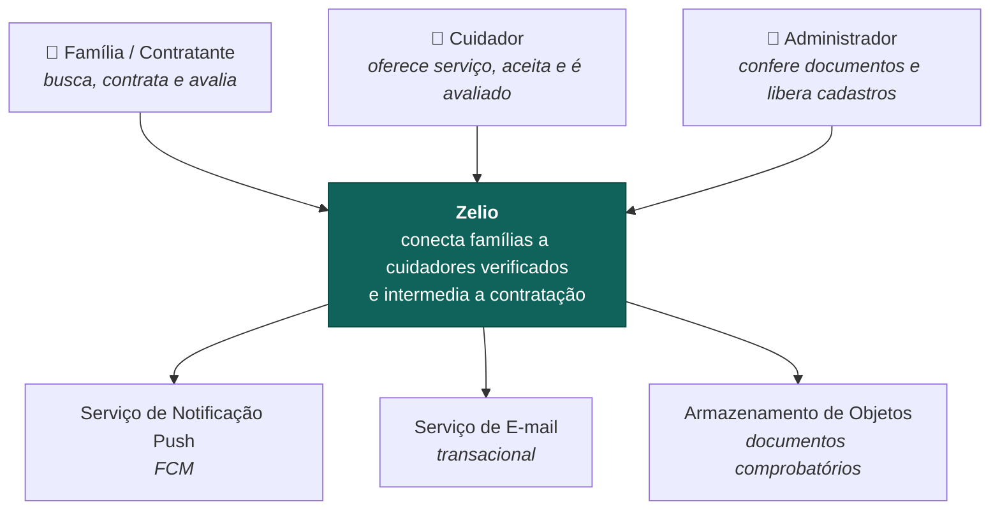
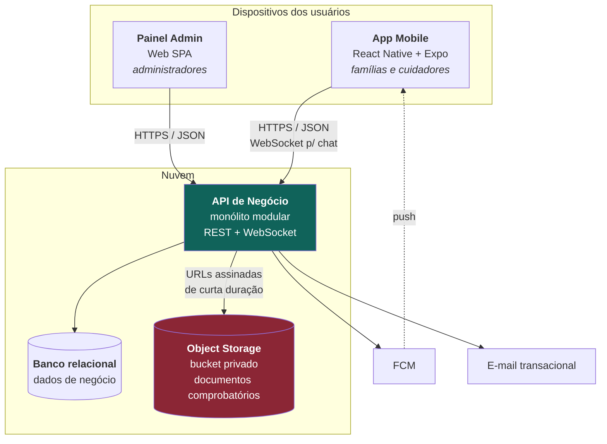
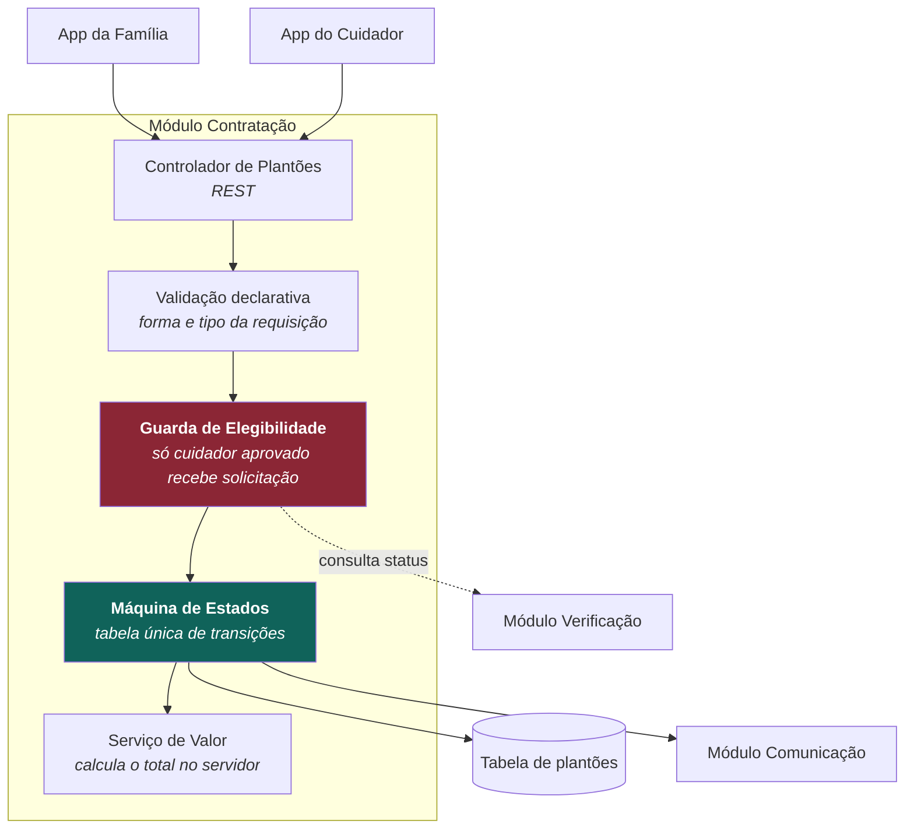
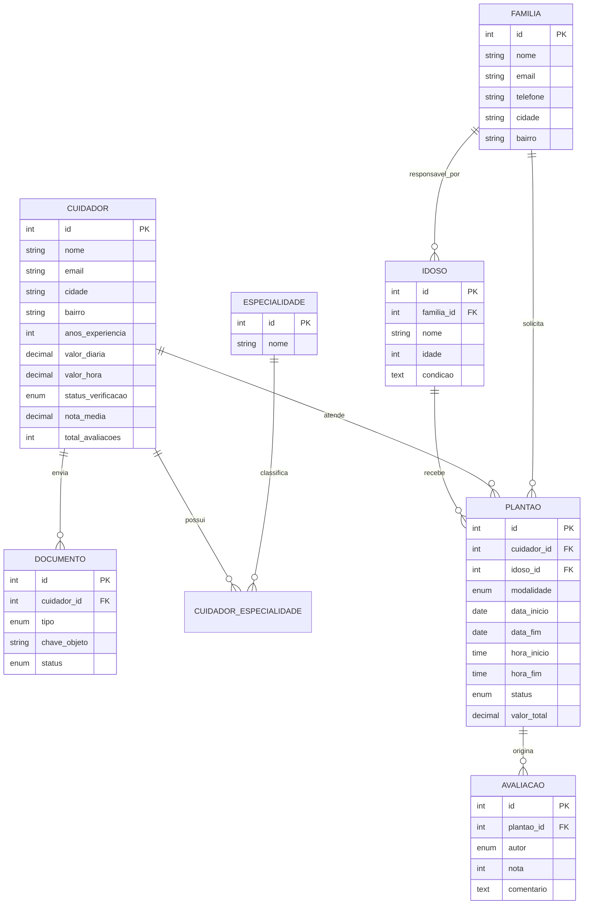
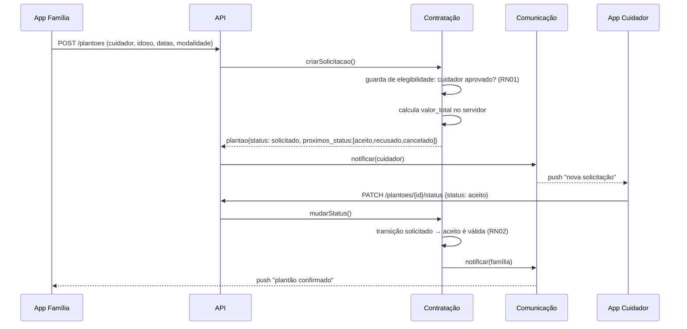
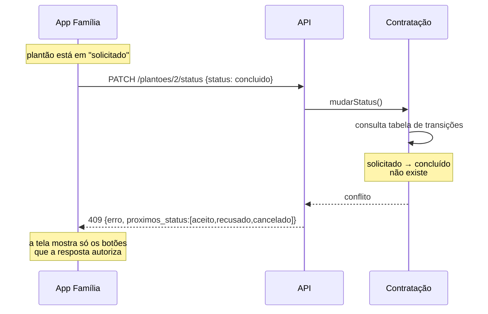
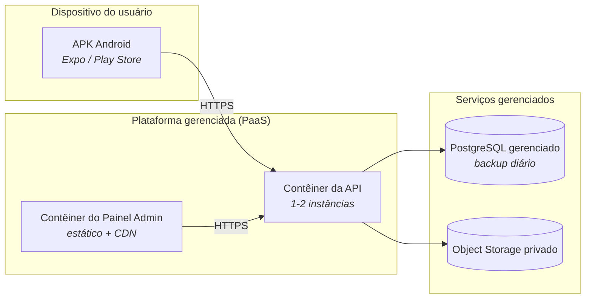

# Documento de Arquitetura de Software v2

## Zelio: marketplace de cuidadores de idosos

**Disciplina:** Projeto Integrado em Engenharia de Software III
**Professora:** Leonara Braz (2026.2, UFC Campus Quixadá)
**Aluno:** Vitor Nayan
**Versão:** 2.0
**Documentos relacionados:** `documento-requisitos-v2.md`, `roteiro-entrevistas-v2.md`

---

## Histórico de versões

| Versão | Data | O que mudou |
|---|---|---|
| v1 | 27/08/2026 | Primeira versão, derivada do documento de requisitos v1 |
| v2 | 28/10/2026 | Redução de escopo para marketplace. Saiu o módulo Acompanhamento e tudo que dependia dele: ADR-05, ADR-06, CQ04, CQ05 e os riscos R01 e R02. Entraram o ADR-09, que registra a distância entre a arquitetura alvo e a implementação atual, e o ADR-10, que separa regra de negócio de acesso a dados |

A v1 descrevia um produto que acompanhava a execução do cuidado. A v2 descreve um
produto que intermedia a contratação e para por ali. Não é um corte de
funcionalidades: é outra tese sobre onde está o valor.

Os identificadores de ADR e de cenário de qualidade foram mantidos. A seção 15
registra o que foi revogado e por quê, porque uma decisão revogada com motivo
escrito vale mais, para quem lê depois, do que uma lacuna silenciosa.

> **Status desta versão.** A arquitetura continua sem validação com stakeholder
> registrada, e as decisões marcadas com ⚠️ dependem disso. A diferença para a v1
> é que parte das decisões agora está implementada e testada, e não apenas
> projetada: a seção 3.3 separa as duas coisas.

---

## 1. Introdução

### 1.1 Objetivo

Descrever a estrutura do sistema, as decisões arquiteturais tomadas, as
alternativas descartadas e a razão de cada escolha, de forma que o MVP possa ser
implementado e que um leitor externo consiga avaliar se a estrutura sustenta os
requisitos.

### 1.2 Escopo

Cobre o MVP: aplicativo mobile para famílias e cuidadores, backend de negócio e
painel administrativo web.

Estão fora do escopo, por decisão de produto registrada na v2 do documento de
requisitos:

- acompanhamento do serviço enquanto ele acontece, incluindo registro diário;
- acionamento de emergência;
- prontuário ou plano de cuidado;
- pagamento intermediado pela plataforma;
- integração automatizada com bases de antecedentes criminais;
- versão iOS e versão web para o usuário final.

### 1.3 Público-alvo do documento

Desenvolvedor do projeto, professora da disciplina e avaliadores do projeto
integrado.

> **Sobre a composição da equipe.** O projeto é desenvolvido por uma única
> pessoa, com autorização da professora. Isso não é um detalhe administrativo: é
> a restrição RES01, que molda boa parte das decisões deste documento.

---

## 2. Drivers arquiteturais

Arquitetura não é decidida por requisito funcional, porque funcionalidade quase
sempre cabe em qualquer estrutura. O que molda a estrutura são atributos de
qualidade, restrições e os poucos requisitos funcionais que são
arquiteturalmente significativos.

### 2.1 Restrições (não negociáveis)

| ID | Restrição | Origem |
|---|---|---|
| RES01 | Um único desenvolvedor, um semestre, sem orçamento de infraestrutura | Contexto da disciplina |
| RES02 | Alvo Android, mínimo 2 GB de RAM | RNF05 |
| RES03 | Tratamento de dado pessoal sensível sob a LGPD: documentos comprobatórios e a descrição da condição do idoso | RNF06 |
| RES04 | Interface utilizável por pessoas com baixa familiaridade digital | RNF01 |
| RES05 | Português do Brasil | RNF04 |

**RES01 é a restrição dominante.** Ela elimina, sozinha, arquiteturas
distribuídas, múltiplos bancos de dados e qualquer coisa que exija operação
contínua. Toda decisão deste documento é lida primeiro contra ela.

RES01 tem uma segunda consequência, menos óbvia e mais séria: **com um só
desenvolvedor não existe revisão por pares**. Todo controle de qualidade que
dependeria de uma segunda pessoa olhando o código precisa ser automatizado, ou
simplesmente não acontece. Isso aparece nas consequências do ADR-01 e na
mitigação do risco R03.

A v2 estreitou a RES03. Na v1 o sistema guardaria medicação, alimentação e
intercorrências registradas todo dia: um prontuário, na prática. Agora o único
dado de saúde é uma frase escrita pela própria família para que o cuidador
decida se aceita o plantão. O volume e a natureza do dado mudaram, e a seção 7.3
trata da consequência jurídica disso.

### 2.2 Requisitos funcionais arquiteturalmente significativos

Dos nove requisitos funcionais da v2, três alteram a estrutura do sistema:

| RF | Por que é significativo |
|---|---|
| **RF02**: envio de documentos comprobatórios | Introduz dado sensível e armazenamento de binários; exige segregação e controle de acesso próprios |
| **RF04**: busca com filtros | Define o modelo de leitura e a estratégia de indexação |
| **RF06**: agendamento de plantões | Carrega a máquina de estados do plantão e a RN02. É o único ponto do sistema com transição de estado não trivial, e decide onde a regra mora |

Os demais (RF01, RF03, RF05, RF07, RF10, RF11) são cadastro, mensageria e
notificação, e cabem na estrutura padrão sem influenciá-la.

Na v1 esta lista tinha quatro itens e incluía RF08 e RF09. Os dois eram
significativos justamente por puxarem a arquitetura para fora do servidor:
operação offline e caminho independente do backend. Com a saída deles a
arquitetura ficou consideravelmente menor, e o RF06 passou a ser o requisito que
mais molda o desenho.

### 2.3 Cenários de qualidade

Requisito não funcional escrito como frase ("deve ser seguro") não é verificável.
Abaixo eles estão reescritos como cenários mensuráveis.

| ID | RNF | Cenário (estímulo, resposta, medida) |
|---|---|---|
| CQ01 | RNF03 | Uma família aplica filtros de especialidade e cidade sobre uma base de 5.000 cuidadores, em 4G. O sistema retorna a primeira página **em até 3 s no percentil 95** |
| CQ02 | RNF01 | Uma pessoa de 60 anos, sem experiência prévia com o app, localiza e contrata um cuidador **em até 5 minutos, sem ajuda**, em teste com 5 participantes |
| CQ03 | RNF02 | Um atacante com acesso ao banco obtém a tabela de documentos. Os arquivos **não são recuperáveis** sem a chave do serviço de armazenamento; nenhum documento é servido por URL pública permanente |
| CQ06 | RNF05 | O app roda em aparelho Android com 2 GB de RAM. Tempo de abertura até a primeira tela útil **abaixo de 4 s** |
| CQ07 | RNF06 | O titular solicita exclusão dos dados. O sistema remove ou anonimiza os dados pessoais **em até 15 dias** |
| CQ08 | RN02 | Uma requisição tenta mover um plantão para um estado não alcançável a partir do estado atual. O sistema **recusa com 409** e informa quais transições existem, em 100% dos casos, verificado por teste automatizado |

CQ04 e CQ05 foram revogados na v2 (seção 15). CQ08 é novo: o que antes era
tratado como regra de negócio solta virou cenário de qualidade verificável,
porque é a propriedade que mais distingue este sistema de um CRUD.

---

## 3. Visão geral da arquitetura

### 3.1 Estilo escolhido

**Monólito modular** no backend, com **cliente mobile híbrido** e integração com
serviços gerenciados para as capacidades que não são o núcleo do problema
(armazenamento de arquivos e notificação push).

O backend é um único serviço implantável, internamente dividido em módulos com
fronteiras explícitas: cada módulo tem seu próprio conjunto de tabelas e expõe
uma interface de serviço; módulos não acessam as tabelas uns dos outros
diretamente. Isso preserva a possibilidade de extrair um módulo no futuro sem
pagar hoje o custo operacional de sistemas distribuídos, custo que RES01 torna
proibitivo.

### 3.2 Módulos do backend

| Módulo | Responsabilidade | RFs |
|---|---|---|
| **Identidade** | Cadastro, autenticação, sessão, perfis | RF01, RF03 |
| **Verificação** | Envio de documentos, fila de moderação, decisão do administrador | RF02, RF11, RN01 |
| **Catálogo** | Perfis públicos de cuidadores, busca e filtros | RF04 |
| **Contratação** | Plantões: solicitação, aceite, recusa, conclusão, cancelamento, aviso de atraso | RF06, RF10, RN02, RN05 |
| **Reputação** | Avaliações mútuas e nota agregada | RF07, RN03, RN04 |
| **Comunicação** | Chat, notificações push, e-mail transacional | RF05, e a entrega das notificações do RF10 |

Na v1 havia um sétimo módulo, Acompanhamento, que guardava os dados de saúde e
concentrava o diferencial do produto. Ele saiu inteiro.

Com a saída dele, a fronteira mais importante passou a ser outra: **Verificação e
Catálogo**. O Catálogo só pode expor cuidador cujo cadastro foi aprovado pelo
módulo Verificação (RN01). É a única regra do sistema que, se falhar, coloca
diante de famílias alguém que ninguém conferiu. Por isso o status de verificação
é propriedade do módulo Verificação, e o Catálogo o lê pela interface de serviço,
nunca pela tabela.

### 3.3 Arquitetura projetada e implementação atual

Este documento descreve a arquitetura alvo. Parte dela já existe em código, e
parte ainda é projeto. Misturar as duas coisas num documento de arquitetura é um
erro comum e caro, porque faz o leitor acreditar que algo está pronto quando não
está.

| Área | Estado |
|---|---|
| Módulos Verificação, Catálogo, Contratação e Reputação | Implementados como camada de serviços da API REST, com teste automatizado das regras RN01, RN02, RN03 e RN05 |
| Máquina de estados do plantão (seção 6) | Implementada |
| Separação em três camadas: rotas, serviços e repositórios (ADR-10) | Implementada. Nenhuma linha de SQL fora de `repositorios/` |
| Módulo Identidade | Não implementado. A API atual não distingue quem chama |
| Módulo Comunicação (chat, RF05) | Não implementado. Exige recurso de tempo real |
| Documentos em bucket privado (ADR-04) | Não implementado. Hoje existe apenas o registro do documento, sem o binário |
| Aplicativo mobile | Não implementado. Existe protótipo navegável de oito telas |

O ADR-09 registra a distância entre a tecnologia alvo e a usada na implementação
atual.

---

## 4. Visão de contexto (C4 nível 1)



O serviço de cuidado em si acontece fora do sistema, na casa do idoso, e o Zelio
não participa dele. O diagrama da v1 trazia uma ligação tracejada do cuidador
para a rede telefônica, que materializava o botão de emergência. Ela saiu junto
com o RF09.

---

## 5. Visão de contêineres (C4 nível 2)



| Contêiner | Tecnologia alvo | Responsabilidade |
|---|---|---|
| App Mobile | React Native + Expo (TypeScript) | Interface de família e cuidador |
| Painel Admin | SPA web (React) | Fila de moderação e métricas: separado por ter público, frequência de uso e requisitos de segurança distintos |
| API de Negócio | Node.js (TypeScript) | Regras de negócio, autorização, orquestração |
| Banco relacional | PostgreSQL em produção; SQLite na implementação atual (ADR-09) | Dados relacionais de negócio |
| Object Storage | S3-compatível, bucket privado | Documentos e certificados: nunca públicos |

O SQLite local do dispositivo, que existia na v1 para a fila de sincronização do
painel de acompanhamento, saiu com o ADR-05.

---

## 6. Visão de componentes do módulo Contratação (C4 nível 3)

Detalhado por ser onde mora a única regra de transição de estado do sistema e o
requisito arquiteturalmente mais significativo da v2 (RF06, RN02, CQ08). Na v1
esta seção detalhava o módulo Acompanhamento.



A **máquina de estados** é a peça central. As transições válidas ficam em uma
única tabela, no serviço, e não espalhadas por condicionais no controlador:

```
solicitado  →  aceito, recusado, cancelado
aceito      →  concluído, cancelado
recusado    →  (final)
concluído   →  (final)
cancelado   →  (final)
```

Duas consequências de desenho vêm daí. A primeira: qualquer transição fora dessa
tabela responde 409 com a lista de destinos possíveis a partir do estado atual,
em vez de uma mensagem genérica de erro. A segunda: a resposta de cada plantão
inclui o campo `proximos_status`, então a tela decide quais botões mostrar lendo
a resposta, em vez de reimplementar a regra no cliente. A regra existe em um
lugar só.

O **aviso de atraso ou cancelamento** (RF10, RN05) entra por esse mesmo módulo, e
não por um módulo de notificação próprio, porque o que ele comunica é um fato do
plantão. O cancelamento avisado não escreve direto na tabela: ele chama a máquina
de estados, como qualquer outra transição. Assim existe um caminho só para mudar
o estado de um plantão, e não dois que precisem ser mantidos em acordo.

A **guarda de elegibilidade** materializa a RN01 do lado da contratação:
solicitar plantão a cuidador não aprovado é recusado, mesmo que o identificador
dele seja conhecido. Não basta não aparecer na busca.

O **cálculo do valor** fica no servidor por princípio: valor enviado pelo cliente
não é confiável. A modalidade mensal aplica desconto, e essa é uma regra de
negócio, não de apresentação.

---

## 7. Dados

### 7.1 Modelo conceitual



Sete entidades. A v1 tinha dez, e as três que saíram eram `PLANO_CUIDADO`,
`REGISTRO_DIARIO` e `ALERTA` — exatamente as do módulo Acompanhamento.

O relacionamento N:N entre cuidadores e especialidades exige tabela de junção, e
é ele que sustenta o filtro da busca (RF04, CQ01). A restrição de unicidade em
`AVALIACAO(plantao_id, autor)` é o que garante, no próprio banco, que cada lado
avalia uma única vez (RN03) — a regra existe na aplicação e também na tabela,
porque regra que só existe em código morre quando alguém escreve direto no banco.

### 7.2 Classificação e segregação de dados

| Classe | Exemplos | Onde vive | Regra de acesso |
|---|---|---|---|
| **Público** | Nome do cuidador, especialidades, nota, cidade e bairro | Banco relacional | Qualquer usuário autenticado |
| **Restrito** | Contato, endereço, valores combinados | Banco relacional | Partes do plantão confirmado |
| **Restrito: condição do idoso** | Descrição curta escrita pela família | Banco relacional | Família responsável, sempre; cuidador apenas a partir da solicitação de plantão, para decidir se aceita |
| **Sensível: documental** | Antecedentes, certificados, RG | Object storage privado, criptografia em repouso; só a chave no banco | Administrador, durante a moderação |

A classe "sensível: saúde" da v1, que cobria plano de cuidado e registros
diários, deixou de existir.

### 7.3 Base legal sob a LGPD

A descrição da condição do idoso é dado referente à saúde e, portanto, dado
pessoal sensível (art. 5º, II). Seu tratamento exige uma das hipóteses do
art. 11.

A hipótese de **tutela da saúde** vale para tratamento realizado por
profissionais de saúde, serviços de saúde ou autoridade sanitária. A plataforma
não se enquadra: é intermediadora entre particulares. Essa conclusão já estava
na v1 e continua valendo — a redução de escopo, se mudou alguma coisa, foi para
reforçá-la, já que o sistema deixou de registrar a execução do cuidado.

A base legal adotada é o **consentimento específico e destacado** do titular
(art. 11, I), coletado do idoso ou de seu representante legal, separado dos
termos de uso, com finalidade explícita e revogável.

Consequências arquiteturais: registro auditável do consentimento por finalidade,
mecanismo de revogação e rotina de eliminação ou anonimização (CQ07).

A redução de escopo diminuiu bastante a exposição. O sistema guarda uma frase
escrita pela família, e não um histórico diário de medicação. A obrigação
permanece; o volume e a sensibilidade do que é guardado caíram.

---

## 8. Cenários de execução

### 8.1 Contratar um plantão (RF06, RN02)



### 8.2 Transição inválida recusada (RN02, CQ08)

O cenário que mais distingue este sistema de um CRUD é o do caminho que não
existe. Ele está implementado e coberto por teste.



A resposta não diz apenas que o pedido falhou: diz o que é possível a partir
dali. É o que permite à interface não duplicar a regra.

---

## 9. Decisões arquiteturais (ADRs)

### ADR-01: Monólito modular em vez de microsserviços

**Contexto.** Um único desenvolvedor, um semestre, sem orçamento nem experiência operacional (RES01).
**Decisão.** Decidi por um único serviço implantável, dividido em módulos com fronteiras de dados explícitas.
**Alternativa descartada.** Microsserviços por domínio, que trazem descoberta de serviço, rastreamento distribuído, consistência eventual e múltiplos pipelines. O custo é pago desde o primeiro dia e o benefício, escala independente, não existe no MVP.
**Consequências.** Deploy e depuração simples. Em contrapartida, a disciplina de fronteira não é imposta pelo runtime, e sem revisor humano (RES01) ela também não pode depender de revisão de código: precisa de teste automatizado que falhe o build ao detectar acesso cruzado a tabelas. Se essa verificação não existir, o monólito vira emaranhado (risco R03).

### ADR-02: React Native + Expo para o app

**Contexto.** Alvo Android com 2 GB de RAM (RES02), um só desenvolvedor, prazo curto, protótipo de alta fidelidade a ser validado com stakeholder.
**Decisão.** Decidi usar React Native com Expo, em TypeScript.
**Alternativas.** *Flutter*: desempenho e consistência visual excelentes, mas exigiria Dart, uma linguagem a mais para aprender, e não compartilha código com o painel admin. *Android nativo (Kotlin)*: melhor desempenho, porém sem reaproveitamento algum e com curva maior. *PWA*: descartada por causa da fragilidade de notificação push confiável no Android.
**Justificativa.** TypeScript unifica app, painel admin e backend, o que para um desenvolvedor sozinho vale mais que os ganhos marginais de desempenho do Flutter num app majoritariamente de formulários e listas. Expo encurta o ciclo de build e distribuição de versões de teste, relevante para validar com stakeholders dentro do semestre.
**Consequências.** Atenção a peso do bundle e uso de memória por causa do RNF05 (CQ06); telas de lista precisam de virtualização.

> A v1 citava a discagem nativa do RF09 como argumento contra PWA. Com a saída do
> RF09 o argumento caiu, mas a decisão não mudou: ela se sustenta sozinha pelo
> compartilhamento de linguagem e pelo push.

### ADR-03: Backend próprio em vez de BaaS

**Contexto.** Um BaaS (Firebase, Supabase) entregaria autenticação, banco e storage prontos, economizando semanas.
**Decisão.** Decidi construir backend próprio, usando serviços gerenciados apenas para armazenamento de objetos, push e e-mail.
**Justificativa.** Duas razões. (1) **Acadêmica:** a disciplina avalia projeto e implementação de arquitetura; terceirizar a camada de negócio esvaziaria o objeto de avaliação. (2) **Técnica:** as regras do sistema são condicionais a estado de negócio — "só cuidador aprovado recebe solicitação", "só plantão concluído pode ser avaliado", "só este conjunto de transições existe". Expressar isso em regras declarativas de BaaS é frágil e difícil de testar; em código de aplicação são explícitas e cobertas por teste automatizado.
**Consequências.** Mais trabalho de infraestrutura e autenticação. Mitigado com biblioteca madura de auth e deploy em plataforma gerenciada (seção 10).

### ADR-04: Documentos sensíveis fora do banco, em bucket privado com URL assinada

**Contexto.** RF02 exige envio de antecedentes criminais e certificados; RNF02 e CQ03 exigem proteção.
**Decisão.** Decidi manter os binários em bucket privado com criptografia em repouso. O banco guarda apenas a chave do objeto e os metadados. Todo acesso é feito por **URL assinada com validade de minutos**, gerada sob autorização da aplicação.
**Alternativas.** *BLOB no banco*: infla o banco, complica backup e não separa a classe de dado. *Bucket público com nome aleatório*: segurança por obscuridade; uma URL vazada expõe o documento para sempre.
**Consequências.** Nenhuma URL permanente de documento existe. Exige rotina de expiração e política de retenção alinhada ao CQ07. Ainda não implementado: a API atual registra o documento e seu status, sem receber o binário.

### ADR-07: Verificação de antecedentes manual no MVP

**Contexto.** RF02, RF11 e RN01 dependem de conferir documentos. Integração automatizada com bases oficiais tem custo, contrato e complexidade legal.
**Decisão.** Decidi manter, no MVP, a análise manual do administrador pela fila de moderação do painel web. A arquitetura isola essa etapa atrás da interface do módulo Verificação.
**Consequências.** O processo não escala, mas não precisa escalar no MVP, e a fronteira do módulo permite substituir o passo manual por integração externa sem tocar no resto do sistema.

### ADR-08: Busca por cidade e bairro, não por raio geográfico

**Contexto.** RF04 e CQ01.
**Decisão.** Decidi filtrar por cidade e bairro, com índices compostos. Sem extensão geoespacial, sem cálculo de distância.
**Justificativa.** Cuidado domiciliar é contratado por região administrativa, não por distância em quilômetros; e o volume do MVP não justifica índice espacial.
**Consequências.** Reavaliar se as entrevistas indicarem que famílias raciocinam em termos de deslocamento ("perto do bairro X") em vez de bairro exato. ⚠️ Depende de validação.

### ADR-09: SQLite e Express na implementação atual, PostgreSQL como alvo

**Contexto.** A arquitetura alvo prevê PostgreSQL gerenciado e um framework de aplicação estruturado. A primeira implementação da API precisava rodar na máquina de quem fosse avaliar, sem instalar servidor de banco, e precisava ficar pronta dentro de uma etapa da disciplina de Programação para Dispositivos Móveis, que exige Node.js com Express.
**Decisão.** Decidi implementar a API com Express e SQLite em arquivo, mantendo as regras de negócio em uma camada de serviços separada das rotas.
**Justificativa.** A reversibilidade depende de existir uma camada de acesso a dados separada, e o ADR-10 a criou: as regras não conhecem o banco nem o framework HTTP, então trocar SQLite por PostgreSQL mexe em `repositorios/` e os testes das regras continuam valendo. O esquema usa chaves estrangeiras e restrições CHECK, que existem nos dois bancos.

> **Correção de registro.** Quando este ADR foi escrito, a justificativa acima
> já estava redigida assim, mas não correspondia ao código: os serviços
> continham SQL. A separação existia entre rotas e serviços, e não entre regra e
> banco. O ADR-10 fechou essa distância. Fica registrado porque um documento de
> arquitetura que descreve o sistema que se gostaria de ter, e não o que existe,
> perde a função.
**Consequências.** SQLite não suporta escrita concorrente de verdade, o que é irrelevante no volume atual e inaceitável em produção. A migração é dívida técnica assumida e está no risco R08. Em compensação, a API sobe com `npm install && npm start`, sem nenhuma dependência externa — o que também a torna demonstrável em sala, sem depender da rede.

### ADR-10: Camada de repositórios separando regra de negócio e SQL

**Contexto.** A API tinha duas camadas: rotas e serviços. Os serviços concentravam as regras de negócio **e** o SQL. Funcionava, mas criava três problemas. O primeiro é que a justificativa do ADR-09 — trocar de banco sem tocar nas regras — não se sustentava, porque as regras estavam misturadas com as consultas. O segundo é que uma mesma consulta aparecia escrita de formas ligeiramente diferentes em serviços distintos. O terceiro é que ler uma regra de negócio exigia atravessar SQL que não tinha nada a ver com ela.

**Decisão.** Decidi introduzir `src/repositorios/`, um módulo por agregado, concentrando todo o SQL do sistema. Serviços passam a depender de repositórios e não do banco. Nenhum `db.prepare` existe fora dessa pasta.

A fronteira tem uma regra que vale a pena explicitar: **o repositório não lança `AppError` e não conhece HTTP**. Quando não encontra, devolve `undefined`. É o serviço que transforma ausência em 404, porque "não encontrado" é uma resposta da aplicação, não do armazenamento. Sem essa regra, a camada de dados começaria a decidir código de status, e a separação viraria enfeite.

**Alternativas.** *Manter duas camadas*: menos arquivos, e defensável num sistema pequeno. Descartada porque o ADR-09 depende desta separação para ser reversível, e porque a disciplina avalia justamente a estrutura. *ORM (Prisma, Sequelize, TypeORM)*: traria o mapeamento pronto, mas esconde o SQL em vez de organizá-lo, acrescenta dependência pesada e tiraria do projeto a parte em que o controle sobre a consulta é visível e avaliável. *Padrão Repository com interface e injeção de dependência*: a formalização completa não se paga num projeto deste tamanho, com um desenvolvedor; o módulo Node já dá o ponto de substituição.

**Consequências.** Mais arquivos e uma indireção a mais para seguir ao ler o código. Em troca: as regras ficam legíveis sem ruído, a consulta de cada agregado tem um lugar só, e a migração do R08 passa a ser uma reescrita de pasta em vez de uma caçada por `db.prepare` espalhado. Os 17 testes passaram sem alteração durante a refatoração, o que é a evidência de que o comportamento não mudou — e também a razão de a refatoração ter sido segura de fazer em uma noite.

---

## 10. Visão de implantação



**Ambientes:** desenvolvimento local, homologação (usada nas validações com
stakeholder) e produção. Pipeline de CI executando lint, testes das regras de
negócio e a verificação de fronteiras do R03 a cada push.

---

## 11. Táticas por atributo de qualidade

| Atributo | Cenário | Tática arquitetural | Como verificar |
|---|---|---|---|
| Desempenho | CQ01 | Índices compostos (`cidade`, `especialidade`, `status`); paginação por cursor; projeção enxuta no perfil de listagem | Teste de carga com base sintética de 5.000 perfis |
| Usabilidade | CQ02 | Fluxos separados por papel desde o login; vocabulário do domínio, não do sistema; alvos de toque grandes; nenhuma etapa obrigatória de mais de 3 campos | Teste de usabilidade com 5 participantes do perfil-alvo |
| Segurança | CQ03 | Bucket privado e URL assinada de curta duração (ADR-04); criptografia em repouso; menor privilégio | Tentativa de acesso direto ao objeto sem assinatura |
| Eficiência de recursos | CQ06 | Listas virtualizadas; imagens redimensionadas no servidor; sem bibliotecas pesadas de UI | Medição em aparelho físico de 2 GB |
| Conformidade | CQ07 | Consentimento registrado por finalidade; segregação por classe de dado; rotina de eliminação | Executar solicitação de exclusão em homologação e auditar resíduos |
| Correção de domínio | CQ08 | Tabela única de transições no serviço; resposta devolve `proximos_status`; restrição de unicidade no banco para a RN03; restrição CHECK na tabela de avisos para a forma do aviso | Teste automatizado por transição inválida; hoje são 17 testes cobrindo as quatro regras |

---

## 12. Rastreabilidade requisito para módulo

| RF | Módulo responsável | Contêiner | Implementado |
|---|---|---|---|
| RF01, RF03 | Identidade | API + banco | Cadastro sim; autenticação não |
| RF02, RF11 | Verificação | API + Object Storage + Painel Admin | Registro e aprovação sim; binário não |
| RF04 | Catálogo | API + banco | Sim |
| RF05 | Comunicação | API (WebSocket) | Não |
| RF06, RF10 | Contratação | API + banco | Sim |
| RF07 | Reputação | API + banco | Sim |

---

## 13. Riscos e dívidas técnicas assumidas

| ID | Risco | Impacto | Mitigação |
|---|---|---|---|
| R03 | Fronteiras entre módulos erodirem com a pressa do semestre | Médio: o monólito modular vira monólito e só | Teste automatizado de dependência entre módulos rodando no CI. Sem revisor humano (RES01), a verificação **precisa** ser automática |
| R04 | Verificação manual (ADR-07) travar por indisponibilidade do desenvolvedor | Médio: cuidadores não entram no catálogo | SLA interno de 48h e indicador de fila no painel admin |
| R05 | Chat próprio consumir tempo desproporcional | Médio | Escopo mínimo: texto puro, sem mídia. Se atrasar, fica para depois do semestre |
| R06 | Base de cuidadores vazia no lançamento, o problema do ovo e da galinha | Alto para o produto, não para a arquitetura | Fora do escopo técnico: tratar na estratégia de validação regional |
| R07 | Nome **Zelio** é foneticamente próximo do concorrente **Zelo** | Médio: confusão de marca e risco de conflito de registro | Consultar busca no INPI antes de investir em identidade visual |
| R08 | Migração de SQLite para PostgreSQL (ADR-09) revelar dependências do dialeto | Médio | Manter as regras fora da camada de dados; evitar recurso específico de SQLite no esquema |
| R09 | O projeto não ter validação com stakeholder registrada até o fim do semestre | **Alto**: todas as decisões de produto seguem apoiadas em suposição, e a disciplina cobra o registro em toda sprint review | Agendar e registrar as conversas; o registro é entregável de sprint, não etapa opcional |

Os riscos R01 e R02 da v1 saíram: o primeiro dependia da hipótese H5, sobre
aceitação do registro diário, e o segundo da indefinição da base legal. O corte
de escopo eliminou o primeiro e fechou o segundo.

---

## 14. Pendências para a v3

1. Autenticação e sessão. A API hoje não distingue quem chama, e sem isso
   nenhuma regra de autorização da seção 7.2 é aplicável de fato.
2. Receber o binário dos documentos e implementar o ADR-04.
3. Revisar ADR-08 à luz das entrevistas.
4. Especificar o contrato da API em OpenAPI.
5. Definir o modelo de negócio e seu impacto arquitetural. Se houver pagamento
   intermediado, entram requisito de PCI e um módulo Financeiro.

---

## 15. Decisões revogadas na v2

Revogar uma decisão não é apagá-la. O que segue estava na v1 e deixou de valer
com a redução de escopo.

| Item | O que dizia | Por que caiu |
|---|---|---|
| **ADR-05** — offline-first no painel de acompanhamento | Escrita local em SQLite no dispositivo, fila de sincronização e idempotência por chave gerada no cliente | Existia para o RF08. Sem registro diário não há escrita na casa do idoso, e a complexidade de sincronização deixou de ter contrapartida |
| **ADR-06** — emergência independente do backend | Acionamento em paralelo por discagem nativa e por API, para o botão funcionar com o servidor fora do ar | Existia para o RF09. A decisão continua correta no mérito: botão de emergência que depende do servidor é pior que nenhum. O que mudou é que o produto não tem mais esse botão |
| **CQ04** | Registro sem conexão sincronizado em até 60 s, sem perda e sem duplicação | Cenário do ADR-05 |
| **CQ05** | Emergência alcança o contato com o backend indisponível | Cenário do ADR-06 |
| **Módulo Acompanhamento** | Registros diários, plano de cuidado e alertas, com guarda de acesso por plantão ativo | Era o módulo do RF08 e RF09 |
| **R01** | Risco de a hipótese H5 ser falsa e derrubar o diferencial | A hipótese era sobre o registro diário. Sem ele, o risco não existe |
| **R02** | Risco de a base legal do dado de saúde estar mal enquadrada | Fechado, não revogado: a seção 7.3 adota consentimento específico e destacado |

A guarda de acesso por plantão ativo, do antigo módulo Acompanhamento, era a
ideia mais interessante da v1: autorizar por relação ativa e não por papel. Ela
não sobreviveu porque o dado que protegia deixou de existir. Vale registrar
porque, se o produto um dia voltar a tratar execução do cuidado, é por ali que
se recomeça.
